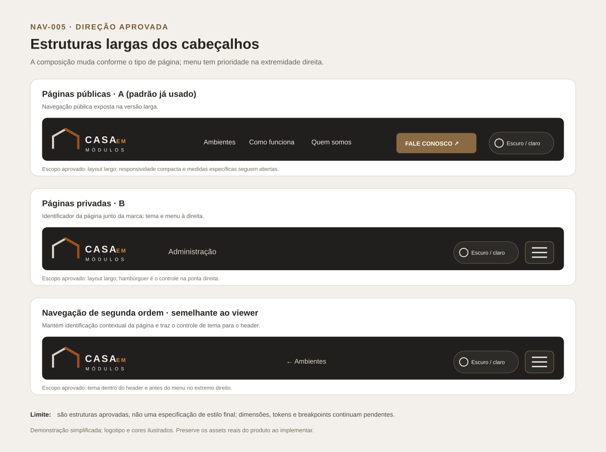
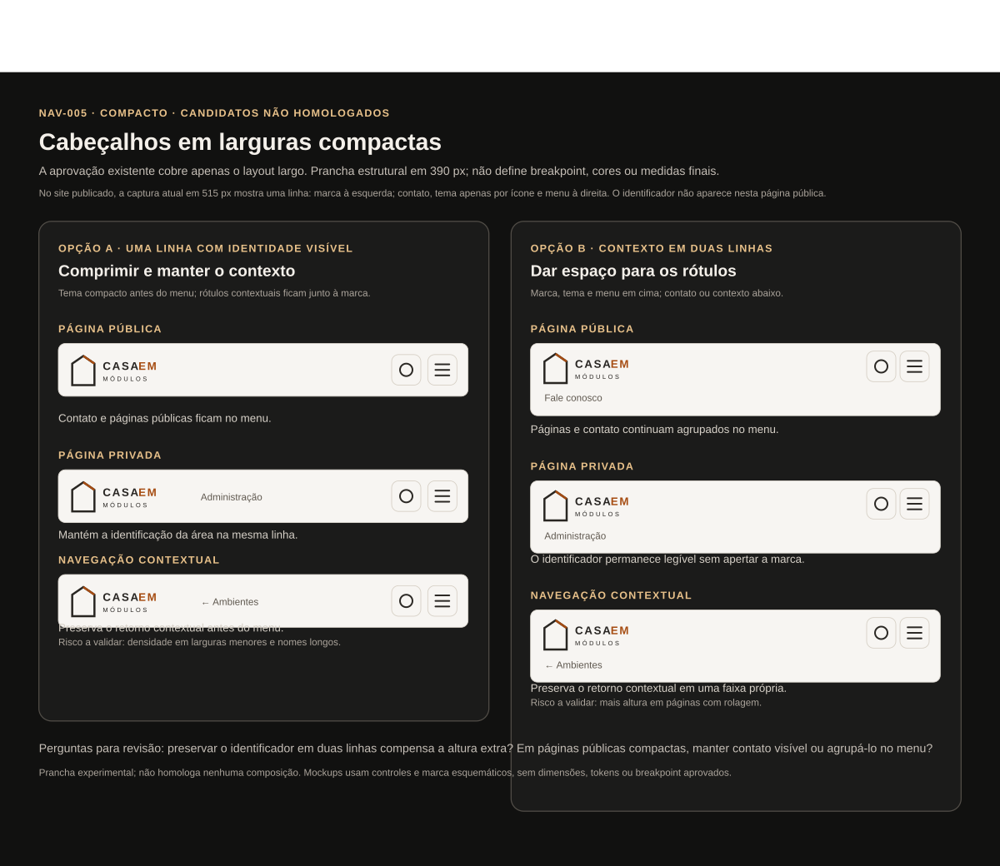
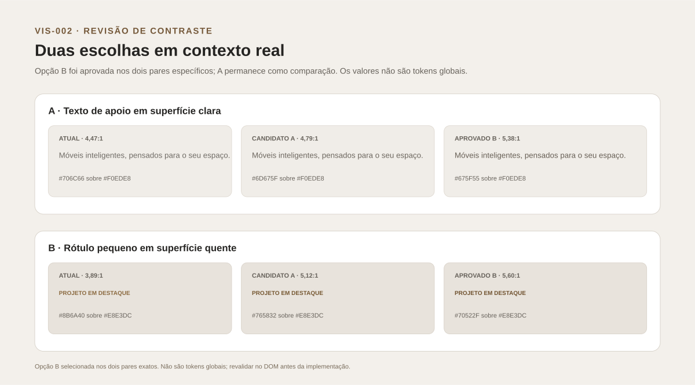
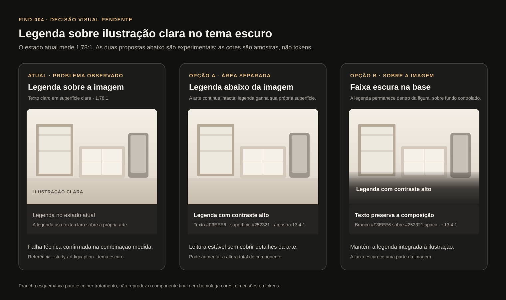

# Registro da revisão visual — NAV-005 e VIS-002

**Status:** seleções do usuário registradas em `decisions.json`. A aprovação cobre apenas os contextos e o escopo descritos.  
**Base da auditoria runtime:** produção em 2026-10-18, deploy Netlify `6ad518d3da1379029e04324f`, commit `298c11441f82cacfff2f809fd9e5ad6f1fc33c0a`.  
**Este pacote não implementa código do produto.**

## NAV-005 — padrões largos de cabeçalho aprovados

- **Páginas públicas:** opção A, navegação exposta como no padrão já usado.
- **Páginas privadas:** opção B, identificador da página/área junto da marca; tema e menu no lado direito.
- **Navegação de segunda ordem:** composição contextual semelhante ao viewer. O controle de tema passa para dentro do cabeçalho e fica antes do menu; se houver hambúrguer, ele ocupa a extremidade direita.

Esta aprovação é para a versão expandida/larga. Breakpoints, composição compacta e medidas não foram definidos. O menu público continua sujeito ao contrato de teclado, Escape, clique fora, aria-expanded, foco e movimento reduzido de NAV-004.

### NAV-005 — composição compacta aprovada

Na página pública publicada `/how-it-works/`, observei em 18/10/2026 um cabeçalho de uma linha em viewport de 515 × 608 px, tema escuro: marca de 160 px à esquerda e grupo de ações de 140 px à direita, com contato, controle de tema em ícone e menu. O cabeçalho mediu aproximadamente 78 px de altura. É uma observação de um único estado público; a escolha estrutural compacta foi registrada separadamente e não pode ser inferida dessa captura.

O usuário escolheu **opção A** para a composição compacta: uma linha; marca e identificador/contexto juntos à esquerda; controle de tema imediatamente antes do hambúrguer, que permanece na extremidade direita. Nas páginas públicas, navegação e acesso de contato ficam agrupados no menu. A opção B permanece na prancha apenas como comparação não selecionada. A estrutura aprovada é composicional; breakpoint, tipografia, dimensões, ícones/estilo dos controles e comportamento de nomes longos continuam pendentes. Admin autenticado e navegação contextual não foram capturados nessa viewport, portanto a prancha é referência esquemática, não evidência runtime dessas rotas.

A escolha A mantém o link atual **Fale conosco** via WhatsApp como acesso público de contato. Isso não cria uma rota própria para Contato.

A prancha anterior de opções permanece em [NAV-005-public-header-options.svg](visualEvidence/experiments/NAV-005-public-header-options.svg) como comparação experimental. A prancha acima registra a escolha estrutural A e mantém B como comparação; não especifica tokens, dimensões nem o logo final.

### Regra compacta estreita aprovada

No login administrativo publicado, o header usa uma linha a 350 e 360 px e duas linhas nos pontos amostrados de 340 px ou menos. A opção A compacta aprovada continua sendo uma linha, com marca e identificador à esquerda, tema antes do menu na extremidade direita. A regra aprovada mantém o rótulo enquanto a logo reduz até 30%; depois, usa ícone-only.

A medição atual encontrou a 320 px: marca + identificador com 189,9 px, logo 105 px, tema 74,1 × 40 px e menu 40 × 40 px. A especificação recomendada pede alvos de 44 × 44 px e gaps definidos; atualizamos a conta para considerar os 8 px entre marca e ações. Assim, o rótulo cabe a partir de aproximadamente 321 px, o tema fica icon-only em 320 px e abaixo, e o modo icon-only mantém uma linha a partir de cerca de 291 px. Abaixo de 291 px, permitir duas linhas.

As medidas recomendadas não são comportamento já existente nem breakpoints de CSS. O runtime foi medido apenas em tema escuro; o CSSOM confirma definições para os dois temas, mas não substitui uma medição renderizada do tema claro. Ver [NAV-005_RUNTIME_VALIDATION_2026-10-18.md](NAV-005_RUNTIME_VALIDATION_2026-10-18.md) para a tabela, cálculo e limites.

## VIS-002 — pares exatos aprovados

O usuário escolheu a opção B nos dois exemplos. `decisions.json` registra estes pares específicos:

- Texto corrido claro: `#675F55` em `#F0EDE8`, 5,38:1, nos contextos auditados da landing, Como funciona e Quem somos.
- Rótulo quente claro: `#70522F` em `#E8E3DC`, 5,60:1, no rótulo auditado de Como funciona.

A aprovação é contextual: não cria tokens globais, não aprova variações dark nem autoriza extensão automática a outros componentes/superfícies. Os pares já atingem o alvo matemático de 4,5:1 para texto comum nas superfícies sólidas avaliadas; a aplicação deve ser revalidada no DOM antes de qualquer implementação do produto. A base promocional `#A64D13` e o azul de informação de processo mantêm seus papéis previamente homologados.

## Ainda aberto

- Revalidar no runtime a futura implementação de NAV-005 nos dois temas; esta sessão mediu a geometria atual apenas no tema escuro.
- Confirmar o fallback com identificadores excepcionalmente longos e a transição recomendada após a implementação.
- Medir outros pares e estados; os dois aprovados não se generalizam.

## FIND-004 — tratamento e par contextual aprovados; aplicação pendente

A auditoria runtime mediu 1,78:1 para `.study-art figcaption` clara sobre a superfície clara da ilustração no tema escuro. Após revisar o caso real publicado em `/how-it-works/`, o usuário escolheu **B — faixa escura na base da ilustração**. A legenda permanece integrada à figura sobre um fundo de contraste controlado.

A escolha posterior do usuário foi A — neutro da interface, com faixa opaca #20211F e texto #F0EDE8. O contraste calculado para esse par é 13,85:1. Esta seleção substitui as amostras experimentais da prancha para este caso e passa a constar como par contextual homologado em decisions.json.

O escopo é somente .study-art figcaption em /how-it-works/, tema escuro. O par não é token global e não se estende automaticamente a outras superfícies. Dimensões, espaçamento e comportamento responsivo ainda precisam ser conferidos ao aplicar; a implementação e auditoria final no DOM permanecem pendentes. A prancha é esquemática e não substitui a página implementada.
